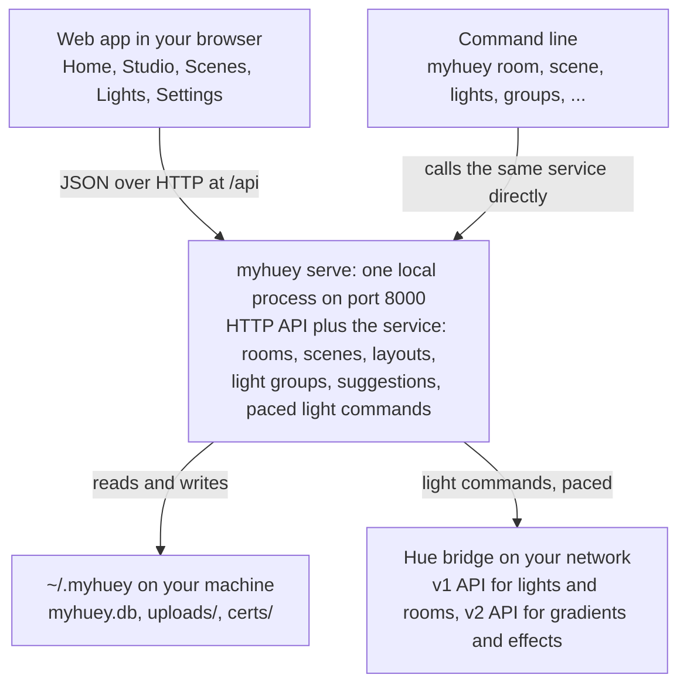

# MyHuey

MyHuey lights your desk so your eyes get less of a beating, using the Philips Hue lights you already own. You draw each room to scale and place the lights where they really sit. MyHuey then works out which lights should stay white, which should dim, and which can carry color, for what you're doing and the time of day.

It runs on your own machine as one small server, with a web app and a command line. It talks to your Hue bridge and nothing else. It's free for non-commercial use.

## Why it exists

I code at a desk, often late. The Hue app is good at "make the living room purple." It knows nothing about where your monitor is, which lamp sits in your line of sight, or that it's 11 pm and you should be winding down.

So the day-to-day job here is small: open it, get to the room you're in, and set it for evening or late work in two taps. Everything else (floor plans, photos, scenes from paintings) is there to make that one job smarter. Some of it is just for fun.

## How it fits together



The web app and the command line share one service, and only that service touches your files and your bridge. The one exception to "nothing goes to the internet" is Hue's discovery service, and MyHuey only calls it when you ask it to find a bridge.

## How to use it

### Install and run

You need Python 3.11 or newer, Node to build the web app once, and a Hue bridge on the same network.

```bash
python3 -m venv .venv
.venv/bin/pip install -e '.[dev]'
npm --prefix frontend install
npm --prefix frontend run build          # builds the web app into static/app

.venv/bin/myhuey bridge setup            # press the round link button on the bridge when it asks
.venv/bin/myhuey serve --port 8000       # then open http://127.0.0.1:8000
```

If you skip `bridge setup`, the web app opens the same pairing wizard the first time you load it.

There's no separate frontend server in normal use: `myhuey serve` runs the API and serves the built app. Day-to-day management looks like this:

| Task | Command |
| --- | --- |
| Stop it | `pkill -f "myhuey serve"` |
| Run it in the background | `nohup .venv/bin/myhuey serve --port 8000 > ~/.myhuey/serve.log 2>&1 &` |
| Check it's up | `curl -s localhost:8000/api/health` should answer `{"status":"ok","api":5}` |

### The window

The app is laid out like a terminal. Tabs along the top open each screen: the 3D view and the workbench for the room you were last in, Home, the floor plan, Scenes, Lights and groups, Settings, and Help. The tabs are yours to arrange: drag one to move it (or Alt-Shift-← → with it focused), close it with its × or a middle click, and bring closed tabs back, or reset them all, from the + at the end. Opening a screen whose tab is closed reopens it. You can move the tabs to a strip above the prompt or to a rail down the left or right side, from the + menu, from Settings, or by typing `tabs bottom`, `tabs left`, `tabs right` or `tabs top`. The top bar also shows the bridge's address and whether it is answering, the theme menu, Workflows, and ⌘K.

A prompt is pinned to the bottom of every screen. Type a command and it runs through the same API the screens use, then shows what really happened and how long it took. Click the line above the prompt for the history. It understands a fixed set of commands and nothing else: it never runs a shell, and nothing runs on the server.

| Command | What it does |
|---|---|
| `room list` | The rooms in the open layout |
| `room on Office`, `room off Office` | Every light in the room on or off |
| `room dim Office 30` | Dim the lit lights |
| `room posture Office standing` | Preview sitting or standing in the 3D view |
| `room glare Office [--mode code] [--fix]` | Check for glare from the desk; `--fix` dims the flagged lights |
| `suggest --room Office --mode code [--apply]` | Eye-comfort suggestions; `--apply` sends the first one |
| `scene list`, `scene apply <scene>` | Saved scenes |
| `groups list`, `groups apply <group>` | Saved groups and their looks |
| `layouts list`, `layouts open <layout>` | Layouts and sandboxes (`active` goes back) |
| `open home`, `open 3d Office`, … | Go to a screen |
| `theme dracula` | Switch theme |

The real CLI's spelling works too (`myhuey room dim --name Office --level 30`), and a command with no room uses the one you were last in. `room posture` and `room glare` exist only in the browser for now. Commands act on the layout named in the prompt, so with a sandbox open they act on the sandbox. Press `/` to jump to the prompt.

⌘K (Ctrl-K) opens a palette that searches rooms, scenes, groups, screens, layouts, themes, help pages, and design steps such as “design a room” or “place lights”; Enter runs the top result, and anything it does not recognise is run as a command. Workflows is a drawer of ready-made commands for the room you are in and your saved groups, each with a Run button and the command to copy.

Side panels fold like an editor's tool windows. Click a panel's title, or the triangle beside it, to hide its contents; Alt-click folds or opens every panel in that sidebar. Folded panels stay folded next time, per browser.

**Help** is built in. The Help tab has a page for each part of the app, searchable, with keyboard shortcuts and commands you can drop into the prompt. The ? in the top bar opens the page for the screen you are on.

### Home

Home is the everyday screen, and it always controls your active home, even while you're trying ideas in a sandbox.

Down the left, Quick settings gives each room a row with how many lights are on, All on, All off, and a brightness slider that moves every lit light in the room together. Next to that is a square tile per room. Each tile shows whether the room is on, how bright it is, and up to five chips of the colors its lights are showing right now. A lit tile glows in its main color.

The ⋮ in a tile's corner is the two-tap path. It opens three eye-comfort suggestions for right now, with a mode picker (Code, Work, Study, Read, Relax) that your browser remembers, plus the room's saved scenes. Tap one and it goes to the lights. Clicking anywhere else on the tile opens that room's workbench.

### Room workbench

The workbench is for using and tuning one room. There's no shape or furniture editing here on purpose; that lives in the Studio.

You get All on, All off, the room dimmer, and a card per light. Click a card for that light's brightness, white temperature (2000 to 6500 K), and color. Gradient lights also get a gradient editor (2 to 5 colors, as a blend, mirrored, bands, or scatter) and effects like candle and fire. The right side lists the room's scenes with Apply, and the full suggestions panel stays open below the lights.

### Studio

The Studio is where you build. Changes here go to whichever layout is open. It is one module with a room menu and four views (the whole-home plan, a room's plan, its 3D view, and its photo): pick any room in the menu and you stay on the same view of it, and its tab opens it without going through the workbench first.

**Floor plan.** Upload a floor plan image (JPEG, PNG, or WebP) and set its scale by dragging a line over a printed dimension and typing its length, like `12' 6"` or `3.8 m`. Then hover inside a room to preview its traced outline and click to keep it. If a spot won't trace, the hint tells you why before you click: it leaks through a doorway, it's on a wall, or it's too small. The Close door gaps slider fixes most doorway leaks. You can also draw rooms by hand (rectangle, L-shape, or corner by corner, snapping to neighbors), drag rooms around, reshape their corners over the image, add a room by width and depth, or import rooms straight from your Hue bridge. Room fill sets how see-through the room shapes are so you can trace without fighting them.

**Layouts and sandboxes.** A layout is a whole home: rooms, scenes, and plan. One is Active and runs the app, and the rest are sandboxes. You can duplicate, rename, delete, or start one fresh. A banner shows while a sandbox is open, with Make active and Back to Active. Sandboxes can still preview on the real lights, which is the point of trying things out.

**Room designer.** Each room opens to scale in feet and inches or meters. Here you edit:

- the outline, with labeled edge lengths
- doors and windows, which count as daylight for glare checks
- furniture at real sizes, including monitors
- lights

Drag paired lights onto the plan and they're drawn the way they actually look: strips long and thin, bars as bars, bulbs round, all worked out from the product data. Each light gets a height (guessed from the product and the furniture under it, or set by you) and a role (Auto, or pinned to Bias, Task, or View). You can also place Hue products you don't own yet. They take part in suggestions without sending anything to the bridge, and you swap them for the real light once it shows up. Arrows nudge, R rotates 15 degrees, Delete removes, and Escape deselects.

**3D view.** The designer's 3D tab draws the same room in three dimensions: walls on its real outline up to the ceiling, doors and windows at their heights, furniture as solids, and each light at its height and real length, in its live color. Drag to orbit, Shift-drag or Space-drag to pan, and use the wheel to zoom toward the cursor (`=`, `-`, and `0` work too). The eye button sits you at the desk, looking at the screen. Drag a light and it slides across the room at its own height; Alt-drag raises or lowers it. Drag a desk and the screens and lights on it come along; Shift-drag turns it. Everything saves to the same room the plan shows.

The 3D screen is three panes. The view is on top, with a switch between looking in from outside and sitting at the desk. Under it is the glare table: every light with its role, position, angle off your gaze, live level, and glare status; click a row to select the light. Beside them is the inspector, with nudge buttons and a height slider for the selected light, the posture switch, and the room's furniture. Drag the bars between panes to resize them, and fold any pane away; the sizes are remembered in your browser.

The glare check is made from the desk seat. It flags lights that bounce off a screen into your eyes, and lights in or near your line of sight, and draws the paths. Lights just behind a screen count as bias lights. Each flagged light gets a level to stay under, and Fix glare dims the lit ones that are over it (it never brightens anything). Standing is a preview: it raises your eyes and any sit-stand desk with what is on it, and it is not saved. The check runs in the browser for now; the `myhuey` CLI and the API do not have it yet, and monitors are assumed to lean back 12 degrees.

**Room photo.** Upload a photo of the real room (it's re-encoded, which strips location data) and pin each light where it appears. Map four floor points between the photo and the plan, and MyHuey can project plan positions onto the photo. That's what powers Setups, which proposes desk lighting (a bias strip behind the monitor, a floor lamp, a desk lamp) on your actual photo before you buy anything. It also lets you preview a suggestion's colors painted onto the photo.

### Eye-comfort suggestions

This is the part the whole app exists for. You pick a mode and a time (now, by default), and MyHuey builds scenes from three inputs: what you're doing, the clock, and where every light sits relative to your desk and screen.

- The clock. White light cools and brightens after your wake time. It warms and dims over the four hours before bed. Blue-heavy palettes drop out from three hours before bed until you wake. You set both times in Settings.
- Your eyes. Lights by the desk stay white (task) and a light just behind the monitor stays dim (bias). Lights in your line of sight or behind your chair get dimmed and kept near white, so the screen isn't fighting glare or reflections. The palette colors the rest of the room.
- Where things sit. Each light's role is worked out per focus (desk, reading chair, sofa) from the plan, which is why it matters to put your monitor on it.

Each suggestion card shows a mini map of the room in the suggested colors and the white temperature near the desk. It has Preview on lights and Save as scene. A saved suggestion is just a scene, so you can edit it like any other. The palettes come from a built-in library, including colors pulled from public-domain paintings at The Met. You can shuffle, browse by tag, or let MyHuey pick.

### Scenes

A scene paints light onto one room. You draw zones (rectangle, ellipse, or freehand) with a color and brightness, and each light takes the color of whatever it sits under. Gradient lights take colors along their length. Lights outside every zone can turn off, stay as they are, take a base color, or take the nearest zone's color.

You can also drop an image on the room. MyHuey pulls a theme from it by mood (colorful, bright, muted, deep, dark), gives every swatch a picker you can drag around the image, and lights take the color beneath them. Any light can be overridden with its own colors, mode, effect, or brightness. You can also recreate any scene from the Hue app's gallery in a room. The color picker works in OKLCH and HCT, with tonal palettes, harmonies, and shades, tints, and tones.

### Lights and saved groups

The Lights tab lists every light on the bridge, grouped by room. Click one to adjust it. Tick several, Cmd/Ctrl-click them, or hit Select all on a room, and the side panel controls them together: on, off, brightness, white temperature, and color. Each change goes only to the lights that can take it. Slider drags are paced to about ten bridge commands a second, because that's roughly what a Hue bridge is happy with.

Save selection keeps a pick as a named group. Groups are stored by MyHuey (nothing is created on the bridge) and every layout sees the same ones. Save current look on a group remembers what each light is showing: on/off, brightness, and its color, exact white temperature, or gradient. After that, ▶ on the group puts them all back in one tap. A light that's gone or refuses the change gets reported, and the rest still change.

### Settings

Settings holds the bridge pairing and the preferences, which the web app and `myhuey prefs` share. The look is an editor's: a flat background, frosted glass panels, JetBrains Mono, and seven themes of its own. Neon is the default, a dark Monokai-style palette. The theme menus also list the colour themes installed in VS Code on this computer and the palettes from Starship's presets, imported by `scripts/import_editor_themes.py`: run it again after installing a theme, then rebuild the web app and restart the server. For a theme you have not installed in VS Code, put its extension folder (the one with `package.json` and the theme's JSON file) in `scripts/extra-themes/` and run the script: that folder is ignored by git, so the theme's own files stay on your computer, and where such a theme keeps a plain interface its syntax colours become the accent and the six hues. Imported themes get the same contrast checks as the built-in ones, so their greys can differ slightly from the editor's. Each theme only recolors the app; the colors of your lights always show as they really are. Every theme's text is checked to read at 4.5:1 contrast or better, so some themes use slightly lighter greys for text than their palettes do. The theme menu in the top bar switches theme from any screen. Pairing works by address or by discovery: local mDNS first, then Hue's discovery service, which allows one request per 15 minutes. The bridge certificate is pinned after pairing, and the dot at the bottom of the side rail tells you whether the bridge is answering.

| Preference | Choices | Default |
| --- | --- | --- |
| Theme | Neon, Monokai, Dracula, Nord, Graphite, Solarized Light, Light, or System | Neon |
| Dark and light theme for System | any dark theme / any light theme | Neon / Light |
| Reduce transparency | Auto (follows your computer), On, Off | Auto |
| Room sliders on Home | on / off | on |
| Sliders only while lights are on | on / off | on |
| Glow around lit lights on plans | on / off | on |
| Read light states every | 0 (on demand), 2, 5, 10, 30 s | 5 s |
| Gap between light commands | 100, 150, 200, 300 ms | 100 ms |
| Units for new rooms | imperial, metric | imperial |
| Wake time / bedtime | any quarter hour | 07:00 / 23:00 |

## Command line

Everything the web app does with rooms, scenes, lights, layouts, and groups also works from `myhuey`. Lengths take units (`12ft`, `12'6"`, `3.8m`, `380cm`), and a bare number means feet in imperial rooms and meters in metric ones. Positions are centimeters from the room's corner. `--layout NAME_OR_ID` works on a sandbox instead of the active layout, and `--db PATH` points at another storage file.

| Command | Actions | What it does |
| --- | --- | --- |
| `myhuey serve` | `--port` | Runs the web app and API |
| `myhuey discover` | | Lists Hue bridges on the network |
| `myhuey bridge` | setup, register, status | Pairs with a bridge or checks the pairing |
| `myhuey room` | list, show, create, update, assign, remove-light, delete, import, photo, remove-photo, on, off, dim, tags, tag, untag, plan-light, swap | Rooms, outlines, lights, photos, power, and brightness |
| `myhuey furniture` | list, add, remove | Furniture in a room |
| `myhuey layouts` | list, new, duplicate, rename, activate, delete | Saved layouts and sandboxes |
| `myhuey scene` | list, show, create, zone, image, preview, apply, delete | Scenes painted onto rooms |
| `myhuey suggest` | `--room`, `--mode`, `--count` | Eye-comfort suggestions for a room |
| `myhuey setups` | | Proposed desk lighting, before you buy |
| `myhuey hue-scenes` | | The Hue gallery, or recreate one of its scenes |
| `myhuey catalog` | | Hue products you can plan with |
| `myhuey palettes` | | Browse the palette library |
| `myhuey palette` | `--file`, `--mood`, `--count` | Pull a color theme from an image |
| `myhuey lights` | list, set, gradient, effect | Lights on the bridge |
| `myhuey groups` | list, new, rename, delete, save-look, clear-look, apply | Saved light groups and looks |
| `myhuey prefs` | show, set | App preferences |

A typical first session:

```bash
myhuey room import                                   # copy your Hue rooms and their lights
myhuey room update --name Office --outline "0,0 14,0 14,8 8,8 8,12 0,12"   # an L-shaped room, in feet
myhuey room assign --name Office --light-id 28 --x 120 --y 40 --rotation 90 --length 2m
myhuey furniture add --room Office --kind desk --width 5ft --depth 30in --x 200 --y 80

myhuey suggest --room Office --mode code
myhuey lights gradient --light-id 28 --colors "#ff4d6d,#ffd166,#3a86ff" --mode segmented_palette

myhuey groups new --name Desk --lights 1,2
myhuey groups save-look Desk
myhuey groups apply Desk
```

Gradient lights take 2 to 5 colors, spaced evenly from start to end, and Hue fixes the spacing. The modes draw them as:

- a blend: `interpolated_palette`
- mirrored from the middle: `interpolated_palette_mirrored`
- hard bands: `segmented_palette`
- scattered: `random_pixelated`

`lights list` shows what each light supports. One bridge quirk to know: setting an effect replaces the gradient, and setting a gradient stops the effect.

## Use it from your assistant

MyHuey ships no AI of its own. `myhuey mcp` is a small tool server that the assistant you already use (Claude Code, Claude Desktop, Cursor, VS Code, or any other that speaks MCP) starts on your own machine, and the skills in `skills/` teach that assistant how to use it well. It runs locally and needs no account or API key. It talks to your bridge on your own network and, for `open_in_app`, to the app's address; it makes no requests to the internet.

The server sends nothing to the internet, but the assistant sees what the tools return (your room names, layouts, and light states), and what it does with that is governed by the assistant you chose, not by MyHuey. The tools never return the bridge key.

The configs below start the server with [uv](https://docs.astral.sh/uv/). If you installed with `python3 -m venv` and pip as above and have no `uv`, point the config at the `myhuey` in that virtual environment instead. It needs no `uv` and works from any folder:

```json
{
  "mcpServers": {
    "myhuey": {
      "command": "/path/to/myhuey/.venv/bin/myhuey",
      "args": ["mcp"]
    }
  }
}
```

In this repo, with `uv` installed, Claude Code needs nothing: `.mcp.json` starts the server with `uv run myhuey mcp`, which works from the MyHuey folder, and `.claude/skills/` holds the skills. Other agents are pointed at them by `AGENTS.md`. For other tools, or another folder, use this config (or the one above). Where it says `/path/to/myhuey`, put the folder you cloned:

```json
{
  "mcpServers": {
    "myhuey": {
      "command": "uv",
      "args": ["run", "--directory", "/path/to/myhuey", "myhuey", "mcp"]
    }
  }
}
```

- **Claude Code:** already set up by `.mcp.json` when you work inside this repo. Elsewhere, paste the snippet above into that project's `.mcp.json`.
- **Claude Desktop:** paste it into `claude_desktop_config.json` (Settings, Developer, Edit Config), then restart the app.
- **Cursor:** paste it into `.cursor/mcp.json` in your project, or `~/.cursor/mcp.json` for every project.
- **VS Code:** put it in `.vscode/mcp.json`, but VS Code names the top key `servers` instead of `mcpServers`.

Apps you open from the dock or Start menu, such as Claude Desktop, often do not see your shell's PATH and cannot find `uv`. Put its full path (what `which uv` prints) in `"command"`, or use the `.venv/bin/myhuey` form.

`myhuey mcp --list` prints the 24 tools, one per line. A different database goes before the command (`myhuey --db PATH mcp`).

If MyHuey runs on a home server and your assistant on a laptop, the assistant starts the server over ssh. Use the form without `uv` on the server, and give `--app-url` the address your laptop's browser uses for the app, so the link `open_in_app` returns opens there:

```json
{
  "mcpServers": {
    "myhuey": {
      "command": "ssh",
      "args": ["you@homeserver", "/path/to/myhuey/.venv/bin/myhuey", "mcp", "--app-url", "http://homeserver:8000"]
    }
  }
}
```

ssh has to log in with a key, since the assistant cannot type a password. `myhuey serve` listens only on 127.0.0.1 unless told otherwise, so start it on the server with `myhuey serve --host 0.0.0.0 --port 8000` for that address to open from the laptop (anyone on your network can then reach the app). The `answering` value `open_in_app` returns is checked from the server's side: it says whether the app is running there, not whether your laptop can reach it.

### What the assistant can and cannot do

It can read your rooms, lights, and scenes, design a scene and preview it, save a scene, and build a room layout. It can also call `apply_scene`, `room_power`, and `room_dim`, the only tools that change real lights, and it is taught to do that only when you ask.

- It builds layouts only in a sandbox, a private copy of your home. Every layout-writing tool refuses the active home.
- It never deletes anything from your active home, and never deletes a layout. It can remove rooms (with their scenes) and lights only inside a sandbox it is building.
- It cannot touch bridge pairing.
- It cannot make a sandbox active. You look at it in the app and do that yourself.
- Planned lights from the catalog take part in roles and previews and are never sent to the bridge.

Two requests to start with:

- *"Make the office easy on the eyes for coding tonight: warm and dim, a little teal behind the monitor. Show me before you apply anything."* The assistant reads the room, previews a scene, and applies or saves it when you say so.
- *"Build my office in a sandbox: 12 by 14 feet, desk on the north wall under the window, door on the south wall."* It builds the room, checks it, and gives you a link that opens the sandbox in the 3D view.

The server also offers two prompts, `design_light_theme` and `design_room_layout`, and a `guide` tool for assistants that do not read skill files. `skills/README.md` describes the skills.

## HTTP API

The web app talks to a local JSON API on the same port, and anything else on your machine can too. Send `X-Myhuey-Layout: <id>` to work on a sandbox; leave it off and you get the active layout. Layouts and groups ignore the header. `GET /api/health` reports the API revision so the page can warn you when the server is older than it. In the table, `…` is short for `/api/rooms/{room}`.

| Area | Endpoints |
| --- | --- |
| Setup and bridge | `GET /api/setup/status`, `GET /api/bridges/discover`, `GET /api/bridges/check`, `POST /api/bridge/register`, `POST /api/bridge/register-any` |
| Lights | `GET /api/lights`, `GET /api/light-profiles`, `PUT /api/lights/{id}/state`, `PUT /api/lights/{id}/gradient`, `PUT /api/lights/{id}/effect` |
| Rooms | `GET/POST /api/rooms`, `POST /api/rooms/import`, `GET/PATCH/DELETE …`, `POST …/power`, `POST …/brightness`, `POST …/lights`, `DELETE …/lights/{id}` |
| Planning | `GET /api/catalog`, `POST …/planned-lights`, `POST …/planned-lights/{id}/swap`, `GET …/setups`, `POST …/setups/apply` |
| Room photo | `POST/DELETE …/photo`, `PUT …/photo/tags`, `PUT …/photo/placements`, `PUT/DELETE …/photo/floor` |
| Floor plan | `GET/PATCH/DELETE /api/plan`, `POST /api/plan/image` |
| Scenes | `GET/POST /api/scenes`, `GET/PUT/DELETE /api/scenes/{id}`, `POST /api/scenes/{id}/apply`, `POST /api/scenes/preview`, `GET /api/hue-scenes`, `POST …/hue-scenes` |
| Suggestions | `POST …/suggest`, `POST …/suggest/apply`, `GET /api/palettes` |
| Images | `POST /api/images`, `GET /api/images/{name}`, `GET /api/images/{name}/theme` |
| Layouts | `GET/POST /api/layouts`, `PATCH/DELETE /api/layouts/{id}`, `POST /api/layouts/{id}/activate` |
| Groups | `GET/POST /api/groups`, `PATCH/DELETE /api/groups/{id}`, `PUT/DELETE /api/groups/{id}/look`, `POST /api/groups/{id}/apply` |
| Preferences | `GET/PATCH /api/preferences` |
| Raw bridge, read-only | `GET /api/hue/{collection}`, `GET /api/hue/{collection}/{id}` |

Errors come back as `{"detail": "…"}`:

| Status | Meaning |
| --- | --- |
| 400 | Bad input |
| 404 | No such room, scene, layout, or group |
| 409 | A race, like pairing already in progress or the active layout just changed |
| 502 | The bridge failed |

## Notes

### Where your data lives

Everything sits under `~/.myhuey`.

`myhuey.db` is SQLite holding one JSON document (table `app_state`, key `config`). It has the pairing, preferences, saved groups, and the active layout's rooms, scenes, and plan, with every length in centimeters. Each other layout is its own record (`layout:<id>`). A `.json` storage path works too, with one file per layout beside it.

Older documents get migrated when they're loaded (the schema is on version 5), and the original of each version is kept as a backup that's never overwritten. Make active swaps layouts in a single transaction. A write that finds the active layout changed underneath it gets refused instead of quietly overwriting it.

`uploads/` holds plan images, room photos, and scene images. Each must be a JPEG, PNG, or WebP of at most 15 MB. Every upload is re-encoded (which strips EXIF data like GPS location) and saved under a name the server picks. Images nothing refers to in any layout get cleaned up.

`certs/` holds the pinned bridge certificate. Your pairing key never leaves the server: no API response or CLI output includes it.

Under the hood, bridge traffic goes through `myhuey.hue.HueBridgeClient`. Pairing, lights, rooms, and plain color changes use Hue's v1 API. Gradients use the v2 (CLIP) API, because that's the only way to set colors along a light's length. The v1 username doubles as the v2 `hue-application-key`.

### Known gaps

These came out of code review and are parked for later. None of them loses data in normal use.

| Area | Gap |
| --- | --- |
| Home | The ⋮ menu gets clipped on phone-width screens. |
| Home | A double tap on a suggestion applies it twice. If suggestions fail to load, the room's scenes hide too. |
| Home | Tile and menu roles aren't great for screen readers yet. |
| Groups | Applying a look briefly flashes a gradient light's old colors, and gradient colors drift slightly over a save and replay. |
| Groups | After you open a group, "Update lights to this selection" is one tap from shrinking it to a single light. |
| Groups | Nothing tells you when some of a group's lights are gone from the bridge. Groups only reload when you open the Lights tab. |
| Lights | The group white-temperature slider always starts at 2700 K. |
| Layouts | On JSON-file storage, a crash mid Make active can leave an undeletable duplicate. A layout ID with "/" in the header returns 500. |
| Layouts | The CLI quietly ignores `--layout` with `layouts`. |
| App | A hand-typed broken address like `#/room/50%` stops the page. |

### Development

Run the API and the Vite dev server side by side. Vite serves the UI with live reload on port 5173 and passes `/api` through to port 8000.

```bash
.venv/bin/myhuey serve --port 8000       # terminal 1
npm --prefix frontend run dev            # terminal 2, then open http://localhost:5173

.venv/bin/pytest -q                      # Python tests
npm --prefix frontend test               # frontend tests
npm --prefix frontend run typecheck
```

### Credits and license

MyHuey is free for non-commercial use.

Light and room icons are path data from [hass-hue-icons](https://github.com/arallsopp/hass-hue-icons) by Andrew Allsopp, licensed [CC BY-NC-SA 4.0](https://creativecommons.org/licenses/by-nc-sa/4.0/), which is non-commercial only (see `frontend/src/components/HUE_ICONS_LICENSE.txt`). Go check out his project, it's what makes the lights look like lights.

Some suggestion palettes take their colors from public-domain paintings in [The Metropolitan Museum of Art's Open Access collection](https://www.metmuseum.org/hubs/open-access) (CC0), and each of those palettes names its painting. MyHuey generates the rest (see `src/myhuey/data/PALETTES_LICENSE.md`). The JetBrains Mono font (OFL) is bundled locally from `@fontsource-variable/jetbrains-mono`, so nothing loads from the internet.
